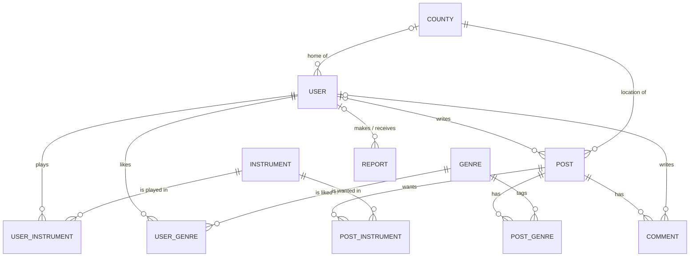

# Band Finder — Data model

This is the source of truth for the Band Finder database. It is built from
`docs2/bandfinder-specification.md`. If the code and this file disagree, stop and check.

Dates and times are stored as TEXT in the form `YYYY-MM-DD HH:MM:SS`.
Dropdown values are stored as the text the user sees (for example `'Original band'`).

## Tables

### user
| Column | Required? | Rules |
|---|---|---|
| id | yes | primary key |
| username | yes | UNIQUE ignoring capitals ("Aoife" = "aoife"), 3–30 characters, only letters, numbers, `_` and `-` (since `002`) |
| email | yes | UNIQUE, must contain `@`, never shown to other users |
| password_hash | yes | the password is stored hashed, never as plain text |
| is_admin | yes | CHECK 0 or 1, default 0 |
| confirmed_adult | yes | CHECK must be 1 (the "I am 18 or over" box) |
| display_name | no | max 50 |
| photo_path | no | file name of the uploaded photo |
| bio | no | max 500 |
| age_range | no | CHECK in ('18-24', '25-34', '35-44', '45-54', '55+') |
| years_playing | no | CHECK between 0 and 80 |
| influences | no | max 500 |
| gear | no | max 500 |
| county_id | no | FK to county (RESTRICT) |
| commitment | no | CHECK in ('Casual', 'Serious') |
| project_type | no | CHECK in ('Original band', 'Covers band', 'Wedding / function band', 'Jam only', 'Session work') |
| availability | no | CHECK in ('Weeknights', 'Weekends', 'Weeknights and weekends', 'Flexible') |
| soundcloud_url, youtube_url, spotify_url, instagram_url | no | must start with `https://` |
| public_email | no | must contain `@`; a contact email shown on the profile |
| public_phone | no | max 20 |
| created_at | yes | default: now |

### instrument / genre / county (the fixed dropdown lists)
| Column | Required? | Rules |
|---|---|---|
| id | yes | primary key |
| name | yes | UNIQUE |

The lists are filled in by `001_initial.sql` (13 instruments, 17 genres, 32 counties).

### user_instrument (instruments a user plays)
| Column | Required? | Rules |
|---|---|---|
| user_id | yes | FK to user (CASCADE) |
| instrument_id | yes | FK to instrument (RESTRICT) |
| skill_level | yes | CHECK in ('Beginner', 'Intermediate', 'Advanced', 'Pro') |

Primary key (user_id, instrument_id): each instrument once per user.

### user_genre (genres a user likes)
| Column | Required? | Rules |
|---|---|---|
| user_id | yes | FK to user (CASCADE) |
| genre_id | yes | FK to genre (RESTRICT) |

Primary key (user_id, genre_id).

### post
| Column | Required? | Rules |
|---|---|---|
| id | yes | primary key |
| user_id | no | FK to user (SET NULL); empty means "Deleted user" |
| title | yes | 1–100 characters |
| description | yes | 1–2000 characters |
| county_id | yes | FK to county (RESTRICT) |
| commitment | yes | CHECK in ('Casual', 'Serious') |
| created_at | yes | default: now |
| expires_at | yes | CHECK after created_at and no more than 30 days after it. The app sets it to 30 days by default |

### post_instrument (instruments a post is looking for)
| Column | Required? | Rules |
|---|---|---|
| post_id | yes | FK to post (CASCADE) |
| instrument_id | yes | FK to instrument (RESTRICT) |

Primary key (post_id, instrument_id).

### post_genre (genres of a post)
| Column | Required? | Rules |
|---|---|---|
| post_id | yes | FK to post (CASCADE) |
| genre_id | yes | FK to genre (RESTRICT) |

Primary key (post_id, genre_id).

### comment
| Column | Required? | Rules |
|---|---|---|
| id | yes | primary key |
| post_id | yes | FK to post (CASCADE) |
| user_id | no | FK to user (SET NULL); empty means "Deleted user" |
| body | yes | 1–1000 characters. Kept even after an admin removes the comment |
| created_at | yes | default: now |
| removed_by_admin | yes | CHECK 0 or 1, default 0 |
| removed_at | no | must be filled in when removed_by_admin is 1, and empty when it is 0 |

### report
| Column | Required? | Rules |
|---|---|---|
| id | yes | primary key |
| reporter_id | no | FK to user (SET NULL); empty means "Deleted user" |
| reported_user_id | no | FK to user (SET NULL); empty means "Deleted user" |
| reason | yes | 1–1000 characters |
| status | yes | CHECK in ('Open', 'Resolved'), default 'Open' |
| created_at | yes | default: now |

CHECK reporter_id is not the same as reported_user_id: nobody can report themselves.

### login_attempt (since `002_username_rules_and_login_limits.sql`)
One row per wrong password, used to stop password guessing.
| Column | Required? | Rules |
|---|---|---|
| id | yes | primary key |
| email | yes | the email typed in, 1–320 characters. Not a foreign key, so attempts on emails that don't exist are counted too |
| attempted_at | yes | default: now (UTC) |

After 5 wrong attempts for one email within 15 minutes, logging in with that email is blocked
until the 15 minutes pass. A successful login deletes that email's rows. Rows older than a day
are tidied away.

### Changes made by `002_username_rules_and_login_limits.sql`
SQLite can't add a CHECK rule to an existing table, so:
- A UNIQUE index on `username COLLATE NOCASE` blocks usernames that differ only in capitals.
- Two triggers (on INSERT and on UPDATE of username) refuse usernames with characters other
  than letters, numbers, `_` and `-`. They act like a CHECK rule.

## Relationships
- A user plays many instruments, each at its own skill level (user_instrument), and likes many genres (user_genre).
- A user lives in one county (optional).
- A user writes many posts. Each post is in one county.
- A post looks for many instruments and has many genres (post_instrument, post_genre).
- A post has many comments. A user writes many comments.
- A user can make many reports and be reported many times.

## Delete rules
| Deleting a... | That still has... | Rule | Reason |
|---|---|---|---|
| user | posts | SET NULL | I want to see the records but show that the user is deleted. |
| user | comments | SET NULL | Same: the comment stays and shows "Deleted user". |
| user | reports they made, and reports about them | SET NULL | Same: the report stays and shows "Deleted user". |
| user | user_instrument, user_genre rows | CASCADE | These only describe that person's profile, so they go with the account. |
| post | comments, post_instrument, post_genre rows | CASCADE | Comments and tags have no meaning without their post. |
| instrument, genre or county | users or posts that use it | RESTRICT | A dropdown item can't be removed while anyone still uses it. |

Side effect of SET NULL: once an author's account is deleted, only an admin can delete their old
posts or comments.

## Rules the app checks (not the database)
- Expired posts (expires_at in the past) are hidden from the post list and "Suggested for you".
- Only the author can edit or delete their own post or comment. Only admins can use the admin page.
- Removed comments show "Removed by admin" instead of the body.

## Diagram

