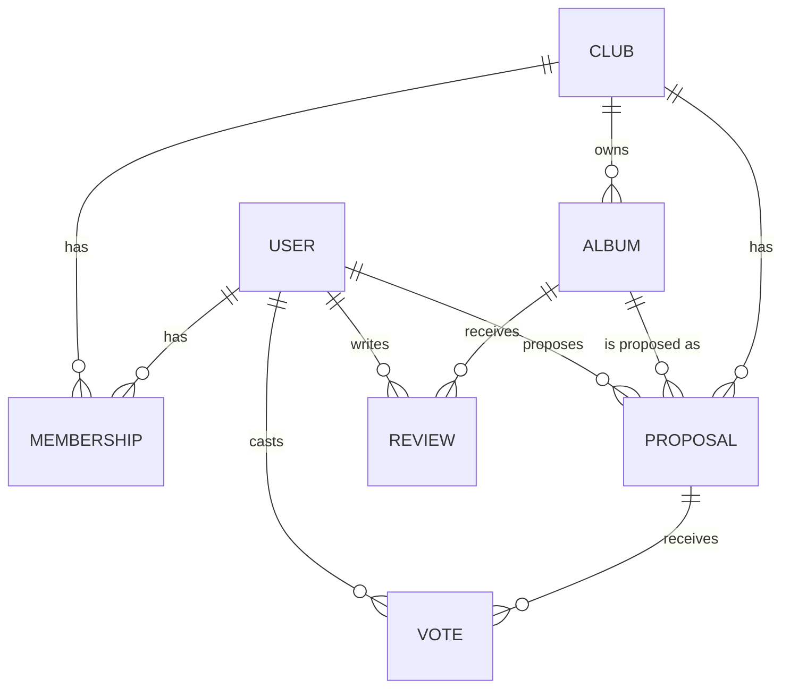

# Data model

## Tables

### user
| Column | Required? | Rules |
|---|---|---|
| id | yes | primary key |
| username | yes | UNIQUE |
| email | yes | UNIQUE |
| password_hash | yes | the password is stored scrambled, never as plain text |
| profile_picture | yes | a stock picture; default is one fixed image path |
| music_taste | no | short description of their music taste |

### club
| Column | Required? | Rules |
|---|---|---|
| id | yes | primary key |
| name | yes | UNIQUE |
| description | yes | NOT NULL (every club must have a short description) |
| invite_code | yes | UNIQUE |
| privacy_setting | yes | CHECK in ('open', 'invite_only') |
| changeover_day | yes | day the weekly album changes, CHECK in Monday to Sunday |

### membership
| Column | Required? | Rules |
|---|---|---|
| id | yes | primary key |
| user_id | yes | FK to user; deleting the user deletes the membership (CASCADE, see delete rules) |
| club_id | yes | FK to club |
| role | yes | CHECK in ('admin', 'member') |
| status | yes | CHECK in ('pending', 'active', 'left') |
| joined_at | yes | date joined, or date the request was made while pending |

UNIQUE (user_id, club_id): one membership per person per club.

### album (each club has its own copy)
| Column | Required? | Rules |
|---|---|---|
| id | yes | primary key |
| club_id | yes | FK to club |
| title | yes | |
| artist | yes | |
| genre | yes | |
| release_year | no | |
| cover_art_url | no | link to an image |
| listening_url | no | link to Spotify, YouTube Music and so on |

### proposal
| Column | Required? | Rules |
|---|---|---|
| id | yes | primary key |
| club_id | yes | FK to club |
| album_id | yes | FK to album |
| proposed_by | no | FK to user (can be emptied) |
| approved_by | no | FK to user, the admin who decided (can be emptied) |
| status | yes | CHECK in ('pending', 'approved', 'rejected', 'winner'), default 'pending' |
| week_start | yes | the week the proposal is for, so winner history is kept |
| created_at | yes | |

### vote
| Column | Required? | Rules |
|---|---|---|
| id | yes | primary key |
| club_id | yes | FK to club |
| proposal_id | yes | FK to proposal |
| user_id | no | FK to user (can be emptied) |
| week_start | yes | |
| created_at | yes | |

UNIQUE (user_id, club_id, week_start): one vote per member per club per week.

### review
| Column | Required? | Rules |
|---|---|---|
| id | yes | primary key |
| album_id | yes | FK to album |
| user_id | no | FK to user (can be emptied) |
| rating | yes | CHECK between 1 and 5 |
| review_text | yes | editable by its author |
| created_at / updated_at | yes | |

UNIQUE (album_id, user_id): one review per member per album, which they can edit.

## Relationships
- A user has many memberships. A club has many memberships. (user and club: many-to-many, through membership)
- A club has many albums, proposals and votes.
- An album has one proposal per club's weekly round and many reviews.
- A proposal has many votes. A user can propose many albums.
- An admin membership approves or rejects proposals.
- A member can review an album only after it has been approved (checked by the app, not the database)

## Delete rules
| Deleting a... | That still has... | Rule | Reason |
|---|---|---|---|
| club | memberships, albums, proposals, votes, reviews | CASCADE | Once a club is deleted all records should be deleted as users data is under the club, username, passwords, records etc. Its good for privacy. |
| user account | proposals, votes, reviews | SET NULL | If a user leaves a club their records should stay as their records provide a history of the club. |
| user account | memberships | CASCADE | If a users account is deleted then the membership has no link. That is why I think it should be deleted. |
| user leaving a club | everything they added | nothing is deleted: membership status becomes 'left' | Similar to before, I think a users activity in teh club should be kept. |
| album | proposals | RESTRICT (since `002_restrict_deletes.sql`) | The database refuses to delete an album that has been proposed. Its proposals, and whether it won, are part of the club's history and should not disappear by accident. |
| proposal | votes | RESTRICT (since `002_restrict_deletes.sql`) | The database refuses to delete a proposal that has votes, so the voting record for each week is kept. |
| album | reviews | CASCADE | Reviews are linked only to an album (they have no club_id of their own). RESTRICT here would stop a club from ever being deleted once it had reviews, which breaks the club CASCADE rule above. In practice reviews are only removed when their whole club is deleted. |

Deleting a whole club still works: the club CASCADE removes its proposals and votes directly (they have their own club_id), so the RESTRICT rules only block deleting a single album or proposal on its own.

## Diagram
